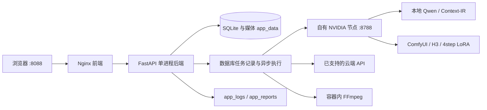

# AI 视频自动化工厂

导入 Word 剧本，或用文字、图片和参考视频生成剧本。应用按镜头调用已配置的模型，完成技术检查和音画合成，直接在项目工作台提供 MP4 下载。

应用支持 Windows、macOS 和 Linux 上的 Linux Docker 容器，包含 Context-IR 和 Fast 4 / Quality 20 / Quality 30 工作流。模型由使用者单独安装或选择云端服务，在 **系统设置 → 服务档案** 填写接口。首次启动从空白业务库开始。

## 1. 下载后启动网页

安装并启动 [Docker Desktop for Windows](https://docs.docker.com/desktop/setup/install/windows-install/)、[Docker Desktop for Mac](https://docs.docker.com/desktop/setup/install/mac-install/) 或 [Linux Docker Engine 与 Compose 插件](https://docs.docker.com/engine/install/)。Windows 使用 WSL 2 后端和 Linux 容器，Mac 选择对应芯片版本。

从本仓库 **Code → Download ZIP** 解压，进入包含 `compose.yaml` 的目录。也可用 Git：

```bash
git clone https://github.com/wAillZhAIng/AI_Video_automation.git
cd AI_Video_automation
docker compose up -d
```

等待首次构建与健康检查完成，打开 **[http://127.0.0.1:8088](http://127.0.0.1:8088)**。首次可直接运行，应用依赖由 Docker 安装。构建需要联网下载基础镜像、锁定依赖和 Debian 软件包。8088 被占用时，将 `.env.example` 复制为 `.env`，修改 `WEB_PORT`。

`compose.yaml` 使用 [Compose 官方支持的 `pull_policy: build`](https://docs.docker.com/reference/compose-file/services/#pull_policy)，所以这条命令会构建本地源码，无需额外输入 `--build`。数据保存在命名卷中，不会因重建镜像而清空。

详细安装见 [Windows](docs/INSTALL_WINDOWS.md)、[macOS](docs/INSTALL_MACOS.md)、[Linux](docs/INSTALL_LINUX.md) 和 [故障排查](docs/TROUBLESHOOTING_ZH.md)。

### 一键管理

| 系统 | 入口 |
| --- | --- |
| Windows | 双击 `Windows管理.cmd`。首次用系统 .NET Framework 编译并打开 `Windows管理.exe`。 |
| macOS | 双击 `macOS管理.command`。若解压器没有保留执行权限，在项目目录执行 `bash ./macOS管理.command`。 |
| Linux | 运行 `bash ./Linux管理.sh`。有 Zenity 桌面环境时显示图形菜单，其他环境显示终端菜单。 |

**一键启动**检查 Docker、启动应用，并在前后端就绪后打开网页。**一键关闭**停止本项目的容器并保留记录。**一键清理**需要确认，永久删除此 Compose 项目的数据库、已保存服务和密钥、上传文件、成片、应用日志与运行报告。清理后重新启动会创建空卷。模型、原始素材和事先下载到卷外的文件由各自的目录管理。

Docker 管理器使用当前用户的 Docker 权限。模型在应用设置中通过接口连接，由模型主机各自管理。多个安装默认共用同一个 Compose 项目名。需要隔离时，为每个安装配置不同的 `COMPOSE_PROJECT_NAME` 和 `WEB_PORT`。清理前核对所用的项目名。

## 2. 单独安装模型与推理节点

网页容器与 GPU 推理节点分开部署：

| 使用方式 | 应用运行位置 | 模型运行位置 |
| --- | --- | --- |
| Windows NVIDIA 本机 | Docker Desktop | 同机独立的 ComfyUI、Qwen、H3 与节点运行环境 |
| macOS / Linux 连接 H3 三档 | Docker | 已配置的 Windows NVIDIA 推理主机，通过受控局域网连接 |
| 云端 API | Windows、macOS 或 Linux 的 Docker | 所选供应商，按实际接入的视频协议配置 |

**先按 [本地推理节点部署教程](docs/local-inference.md) 安装模型、依赖和项目节点，再做接口配置。** 仓库提供 `scripts/local_inference/` 的部署工具、`runtime-manifests/` 的来源校验清单，以及 `workflows/` 的工作流；不自动重新下载已有权重，不把模型打入普通应用容器。

Context-IR 节点入口默认端口为 **8788**，内部协调 ComfyUI 与本地视觉语言服务。只运行普通 ComfyUI 的 8188/8189 端口，或仅能访问 `/v1/models`，都不足以说明 Context-IR 已部署完成。需要对应节点、模型、受支持的运行版本和真实图像理解能力。

这套原生 Context-IR/H3 三档基于 Windows NVIDIA CUDA。macOS 和 Linux 可以运行应用并连接兼容节点或云端。平台验证范围见 [发布验收](docs/RELEASE_VALIDATION.md)。

## 3. 在设置页连接自己的服务

在 **系统设置 → 添加服务** 中按用途保存服务档案。配置本地 H3 三档视频：

1. 服务用途选 **视频生成**，提供商选 **本地 / 私有 ComfyUI**。
2. 内置视频工作流选 **Context-IR 三档：Fast 4 / Quality 20 / Quality 30**。
3. 同一台 Docker Desktop 宿主机填 `http://host.docker.internal:8788`；另一台自有 GPU 主机填实际受控地址，例如 `http://192.168.1.20:8788`。
4. 勾选 **确认这是我管理的本地模型服务**，保存后点 **测试连接**，根据实际诊断补齐模型或节点。
5. 在项目的视频服务选择处采用这个档案，保存项目配置。

这条路径无需修改 `.env`。本地信任只用于该档案的精确服务地址，不会放开任意文件导入或媒体 URL。容器内的 `localhost` 指向容器自身；远程服务还需正确监听并允许受控网络访问。HTTP 只用于明确确认的本地/私有推理服务，云端地址仍需 HTTPS。

其他用途也要按实际适配器配置和测试。图像、语言、视频接口不是同一种协议；本机语音/口型的 CLI 适配器不能凭一个任意 HTTP 地址变成远程服务。密钥只在设置页输入并加密保存。更多说明见[完整使用教程](docs/USER_GUIDE_ZH.md)。

## 4. 选择三档与参考素材

在**系统设置的制作画质**或**项目的制作画质**中选择并保存：

| 网页选项 | 实际工作流 | 采样步骤 |
| --- | --- | --- |
| Fast | `H3_R2V_OpenH3IR_SMD4_Fast`，加载对应 4step LoRA 与固定采样配方 | 4 |
| 标准 | `H3_R2V_OpenH3IR_Quality` | 20 |
| 高质量 | `H3_R2V_OpenH3IR_Quality` | 30 |

三档都启用 Context-IR：读取上传的图片、文字和参考视频，编译镜头要求后交给 H3。参考视频默认提供动作/摄影结构；人物和产品身份仍由明确绑定的图片与剧本要求确定。四步方案需要实际 LoRA 和节点支持，不能只把步数改成 4。

新任务冻结工作流、采样步骤、素材哈希和模型服务快照；改档不会替换已经提交的任务。可在视频任务的**提示词、参考与复现快照**查看实际执行配置。后期超分、生成原始尺寸与最终合成尺寸分别设置；选择 4K 不代表模型原生生成 4K。

## 5. 下载 Word 模板并完成第一条视频

当前空白模板：**[剧本模板.docx](docs/templates/剧本模板.docx)**。也可以在**项目工作台 → Word 导入 → 下载 Word 模板**获取同一文件；[完整示例](docs/templates/剧本导入示例.docx)保留供字段对照。

1. 保留模板标题、表格字段与列名，填写项目、人物、场景、道具、分镜、摄影、对白和声音策略。固定产品名称要与图库一致。
2. 配置好模型和画质后，点击 **导入并自动成片**。需要先添加人物、产品或声音参考时，选 **仅导入，先配置素材**，保存后点 **开始／增量续作**。
3. 也可在 **剧本生成** 提交文字、图片或参考视频，并保留 **剧本生成后自动制作成片**。剧本与 Word 保存后，后端自动建项并提交制作。
4. 分镜和技术检查完成后，系统按剧本顺序自动合成。在 **项目工作台 → 自动成片** 播放和下载 MP4。未指定转场时使用硬切。出现成片阶段错误时，可在解决错误后重试成片，复用本次分镜。

先用一条短镜头验证实际出片，再扩展整集。操作细节见 [Word 到 MP4 教程](docs/USER_GUIDE_ZH.md)。

主导航按 **项目工作台 → 剧本生成 → 脚本与分镜 → 系统设置** 排列。旧成片链接跳转至相同项目的自动成片区域。

对白比镜头长时，在 **项目工作台 → 需要处理的异常** 选择 **延长镜头／缩短台词／调整语速**，预览后确认。系统重新处理受影响的镜头，再续接自动成片。操作和适配器限制见 [对白超长处理](docs/对白超长处理.md)。

项目工作台仍提供分镜和任务状态，便于定位异常。更新应用时按 [本地推理节点教程](docs/local-inference.md) 同步检查推理主机上的项目自有节点。

## 6. 服务、数据与日常维护



Compose 只有前端、后端两个服务；SQLite 与任务队列不依赖另装 PostgreSQL 或 Redis。后端保持单进程，不要同时启动多份后端共享同一套数据卷。首次启动自动迁移并建立空白业务库；不带维护者的历史记录、素材、密钥或模型。

`app_data` 保存数据库、用户素材、生成结果和 `/app/data/.secrets/master.key`，`app_logs` 和 `app_reports` 保存日志及报告。默认卷名前缀为 `ai-video-automation`。每个项目名对应一套数据，备份时用下方专用脚本。

```bash
docker compose ps
docker compose logs --tail=100 backend frontend
docker compose exec backend python -m app.container_entrypoint doctor
docker compose stop
docker compose start
```

升级前用 Windows 的 `./scripts/backup-docker.ps1` 或 macOS/Linux 的 `bash ./scripts/backup-docker.sh` 备份，随后更新源码并运行 `docker compose up -d`。备份包含数据库、文件与解密主密钥，需要作为私有数据保存。恢复步骤见 [备份与恢复](docs/DOCKER_RELEASE_GUIDE_ZH.md)。

应用及模型诊断见 [运行状态](http://127.0.0.1:8088/api/health/runtime)。`application_ready: true` 表示网页可用。配置服务档案并出片后即可确认对应模型链路。

## 其他部署方式

- **预构建镜像**在 [发布工作流](https://github.com/wAillZhAIng/AI_Video_automation/actions/workflows/publish-ghcr.yml) 成功后，可用 `docker compose -f compose.prebuilt.yaml up -d` 拉取。需要与源码版本严格一致时，使用默认源码构建。
- **独立开发环境**运行 `docker compose -f compose.dev.yaml up -d --build`，默认项目 `ai-video-automation-dev`、端口 `18088`。
- **可选部署参数：** `.env.example` 可调整端口、镜像源及管理员默认地址；普通设置页服务配置无需编辑它，不在文件中填写真实 API Key。

模型许可证、显存与运行框架限制由用户按模型官方说明核对。项目自有代码许可证见 [LICENSE](LICENSE)，第三方内容见 [THIRD_PARTY_NOTICES.md](THIRD_PARTY_NOTICES.md)。
